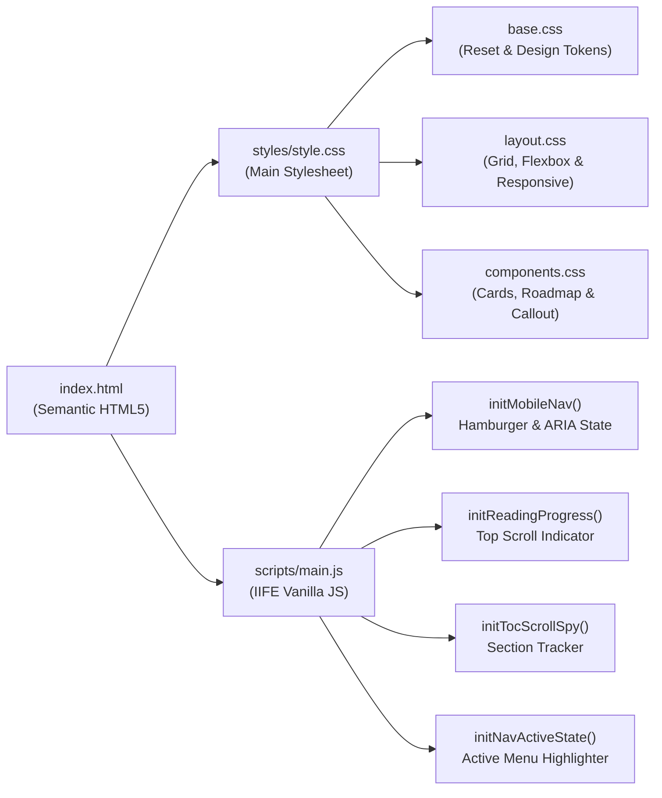

# 🧭 TapakKarir.id — Panduan Karier Digital Indonesia

[](https://developer.mozilla.org/en-US/docs/Glossary/Semantics#semantics_in_html)
[](https://developer.mozilla.org/en-US/docs/Web/CSS)
[](https://developer.mozilla.org/en-US/docs/Web/JavaScript)
[](https://web.dev/articles/responsive-web-design-basics)
[](https://fonts.google.com/)
[](https://fontawesome.com/)

> **Tugas Akhir:** _Membuat Website (TapakKarir.id)_  
> Program **Belajar Dasar Pemrograman Web** — **Dicoding Indonesia**  
> Kolaborasi Program **Asah led by Dicoding Supported by GoTo** & **PLK Akomodasi Klaim Universitas Negeri Yogyakarta (UNY) Studi Mandiri**.

---

## 📑 Daftar Isi

- [Tentang Proyek](#-tentang-proyek)
- [Kriteria Tugas Akhir & Fitur Lengkap](#-kriteria-tugas-akhir--fitur-lengkap)
  - [Kriteria 1: Struktur Elemen Semantik HTML5](#kriteria-1-struktur-elemen-semantik-html5)
  - [Kriteria 2: Tata Letak Flexbox, CSS Grid & Desain Responsif](#kriteria-2-tata-letak-flexbox-css-grid--desain-responsif)
  - [Kriteria 3: Identitas Kreator & Tautan Profil Dicoding](#kriteria-3-identitas-kreator--tautan-profil-dicoding)
  - [Kriteria 4: Interaktivitas DOM & Pengalaman Membaca (Vanilla JS)](#kriteria-4-interaktivitas-dom--pengalaman-membaca-vanilla-js)
  - [Standar Desain Sistem & Aksesibilitas yang Diterapkan](#standar-desain-sistem--aksesibilitas-yang-diterapkan)
- [Struktur Halaman & Navigasi Konten](#-struktur-halaman--navigasi-konten)
- [Sistem Desain & Spesifikasi Visual](#-sistem-desain--spesifikasi-visual)
- [Struktur Direktori](#-struktur-direktori)
- [Arsitektur Komponen & Modul Interaktif](#-arsitektur-komponen--modul-interaktif)
- [Teknologi yang Digunakan](#-teknologi-yang-digunakan)
- [Panduan Menjalankan Proyek](#-panduan-menjalankan-proyek)
  - [Prasyarat](#prasyarat)
  - [Opsi 1: Membuka Langsung melalui Browser](#opsi-1-membuka-langsung-melalui-browser)
  - [Opsi 2: Menggunakan Ekstensi Live Server (VS Code)](#opsi-2-menggunakan-ekstensi-live-server-vs-code)
  - [Opsi 3: Menggunakan Local HTTP Server (Terminal)](#opsi-3-menggunakan-local-http-server-terminal)
- [Panduan Pengujian & Verifikasi Kualitas](#-panduan-pengujian--verifikasi-kualitas)
  - [1. Pengujian Responsivitas Antarmuka (DevTools)](#1-pengujian-responsivitas-antarmuka-devtools)
  - [2. Pengujian Navigasi & Fitur Interaktif](#2-pengujian-navigasi--fitur-interaktif)
  - [3. Validasi Standar HTML, CSS & Aksesibilitas](#3-validasi-standar-html-css--aksesibilitas)
- [Dokumentasi Arsitektur & Keputusan Teknis](#-dokumentasi-arsitektur--keputusan-teknis)
- [Developer](#-developer)

---

## 📖 Tentang Proyek

**TapakKarir.id** adalah platform panduan edukatif berbasis web yang dirancang khusus untuk membantu *fresh graduate* dan mahasiswa Indonesia memulai perjalanan karier di industri digital secara terarah. Di tengah pesatnya pertumbuhan ekonomi digital Asia Tenggara, banyak talenta muda memiliki potensi besar tetapi terkendala kebingungan dalam menentukan langkah awal.

Website ini dibangun menggunakan **HTML5 Semantik, CSS3 Modular, dan Vanilla JavaScript murni** tanpa ketergantungan pada *framework* antarmuka eksternal (seperti Bootstrap atau Tailwind CSS). Konten disajikan melalui pendekatan editorial yang terstruktur ke dalam tiga pilar utama:

1. **Pemetaan Jalur Karier Digital** yang paling dibutuhkan industri di Indonesia (*Frontend Developer*, *UI/UX Designer*, *Data Analyst*, dan *Digital Marketer*) lengkap dengan indikator permintaan pasar dan daftar keahlian inti.
2. **Kurasi Fondasi Skill Universal** yang relevan lintas profesi digital, mulai dari kemampuan belajar mandiri, komunikasi tertulis, pemahaman *version control* (Git), hingga *mindset problem-solving*.
3. **Roadmap Aksi 90 Hari & Resource Terpercaya** yang memandu pembaca beralih dari tahap persiapan menuju langkah konkret membangun portofolio, jejaring profesional, dan kesiapan kerja.

---

## 🏆 Kriteria Tugas Akhir & Fitur Lengkap

### Kriteria 1: Struktur Elemen Semantik HTML5

- **`<header>` (`role="banner"`):** Menampilkan identitas utama `TapakKarir.id` (logo & tipografi merek), bilah navigasi utama `<nav>` yang bersifat *sticky* di bagian atas layar, tombol akses cepat menuju Profil Dicoding, serta tombol *hamburger* untuk perangkat *mobile*.
- **`<main>` (`#main-content`):** Membungkus keseluruhan konten utama halaman secara terpisah dari `<header>` dan `<footer>` sesuai standar spesifikasi W3C HTML5.
- **`<article>` & `<section>`:** Menyusun narasi panduan karier secara hierarkis dan bermakna melalui elemen `<article>` yang terbagi ke dalam beberapa `<section>` tematik ber-`aria-labelledby` jelas (*Kenapa Karier Digital*, *Jalur Karier*, *Skill Dasar*, dan *Langkah Awal*).
- **`<aside>` (`.intro-aside`):** Menyajikan konten pendamping kontekstual di samping pengantar artikel berupa ilustrasi visual (`aside-illustration.jpg`) dan kotak catatan penting (*callout* **"Perlu diingat"**) yang memperkaya pemahaman pembaca bahwa karier digital mencakup spektrum peran yang luas.
- **`<footer>` (`role="contentinfo"`):** Memuat ringkasan identitas merek, tautan cepat menuju setiap bagian konten, tautan jejaring profesional (Dicoding, GitHub, LinkedIn), serta atribusi hak cipta kreator.

### Kriteria 2: Tata Letak Flexbox, CSS Grid & Desain Responsif

- **Implementasi Murni Tanpa Framework CSS:**
  - **CSS Grid:** Diterapkan pada `.hero-grid` (`grid-template-columns: 1fr 1fr`) untuk menyeimbangkan teks pengantar dan ilustrasi utama, serta pada `.intro-grid` (`grid-template-columns: 3fr 2fr`) untuk menyandingkan konten utama artikel dengan elemen `<aside>`.
  - **CSS Flexbox:** Diterapkan pada susunan `.header-inner`, `.site-nav`, `.nav-list`, kartu karier (`.career-card-header` & `.career-card-skills`), daftar keahlian (`.skill-item`), alur *roadmap* vertikal (`.roadmap-item`), kartu referensi belajar (`.resource-item`), hingga struktur `.footer-top` dan `.footer-bottom`.
- **Responsivitas Multi-Perangkat (*Media Queries*):**
  - **Desktop (`> 767px`):** Menampilkan navigasi horizontal penuh, tata letak Hero dua kolom, dan proporsi pengantar artikel beserta `<aside>` secara berdampingan.
  - **Tablet & Mobile (`<= 767px`):** Mengubah menu navigasi menjadi *collapsible mobile drawer* beranimasi halus, menyusun ulang `.hero-grid` dan `.intro-grid` menjadi satu kolom (`1fr`) dengan ilustrasi utama diposisikan di atas (`order: -1`), serta merapikan susunan *footer* secara vertikal.
  - **Layar Mobile Kecil (`<= 479px`):** Menyesuaikan ruang tepi kontainer (`padding-inline: var(--space-4)`) agar seluruh kartu, *badge*, dan teks tetap proporsional tanpa *horizontal scrolling*.

### Kriteria 3: Identitas Kreator & Tautan Profil Dicoding

- Menyediakan tautan langsung menuju **Profil Dicoding resmi kreator** (`https://www.dicoding.com/users/alfinhimawan/academies`) baik pada bagian kanan bilah navigasi utama (`.nav-link--profile`) maupun pada bagian `<footer>`.
- Seluruh tautan eksternal dilengkapi atribut keamanan `target="_blank"` dan `rel="noopener noreferrer"` serta deskripsi `aria-label` yang informatif.
- Menggunakan aset logo, ikon platform, dan ilustrasi kontekstual yang tertata rapi di dalam direktori `assets/images/`.

### Kriteria 4: Interaktivitas DOM & Pengalaman Membaca (Vanilla JS)

- **Reading Progress Bar (`#readingProgress`):** Bilah indikator progres baca di tepi atas layar yang menghitung persentase gulir (*scroll*) pembaca terhadap tinggi elemen `.site-main` secara *real-time* menggunakan `{ passive: true }` *event listener*.
- **Automatic Navigation Scroll Spy (`initNavActiveState`):** Mendeteksi posisi gulir pengguna terhadap setiap `<section>` dengan kompensasi tinggi *sticky header* (`80px`), lalu memperbarui class `.nav-link--active` dan atribut `aria-current="page"` secara otomatis.
- **Accessible Mobile Drawer (`initMobileNav`):** Mengelola interaksi buka/tutup menu *hamburger* beserta transformasi ikon tiga garis menjadi tanda silang (`X`), sinkronisasi atribut `aria-expanded` dan `aria-label`, penutupan otomatis saat pengguna mengeklik area di luar menu (*click outside*), saat memilih menu navigasi, maupun saat ukuran layar kembali ke tampilan desktop.
- **Modular TOC Scroll Spy (`initTocScrollSpy`):** Dukungan *scroll spy* modular berbasis atribut `data-section` dengan pemeriksaan elemen yang aman (*null-safe guard*).

### Standar Desain Sistem & Aksesibilitas yang Diterapkan

- **Design Tokens Terpusat (`:root` CSS Custom Properties):** Pengelolaan warna merek, skala tipografi, skala *spacing* berbasis `4px/8px`, radius sudut, bayangan (*elevation shadows*), dan transisi di satu tempat (`styles/base.css`).
- **Aksesibilitas Inklusif (WAI-ARIA & WCAG):** Dukungan navigasi *keyboard* melalui indikator `:focus-visible` yang tegas, lebar baris teks optimal (`max-width: 68ch`) untuk mencegah kelelahan mata, serta penghormatan terhadap preferensi sistem pengguna melalui `@media (prefers-reduced-motion: reduce)`.

---

## 🧭 Struktur Halaman & Navigasi Konten

Seluruh alur baca dirancang berkesinambungan dalam satu halaman terpadu (`index.html`):

| Urutan | Bagian / Landmark | Selector / ID | Teknik Layout | Deskripsi Konten |
| :----- | :---------------- | :------------ | :------------ | :--------------- |
| `1` | **Reading Progress** | `#readingProgress` | `position: fixed` | Indikator visual progres membaca artikel dengan gradien warna primer ke aksen |
| `2` | **Site Header & Nav** | `.site-header`, `#siteNav` | Flexbox + `sticky` | Logo `TapakKarir.id`, 4 menu jangkar internal, tombol Profil Dicoding, & *hamburger toggle* |
| `3` | **Hero Section** | `#beranda` | CSS Grid (`1fr 1fr`) | Judul utama berpenekanan `<mark>`, deskripsi nilai produk, tombol CTA *Mulai Membaca*, & ilustrasi utama |
| `4` | **Pengantar & Aside** | `#kenapa-digital-section` | CSS Grid (`3fr 2fr`) | Konteks peluang ekonomi digital Indonesia pada `.intro-content` berdampingan dengan `<aside>` *callout* |
| `5` | **Jalur Karier** | `#jalur-karier` | Flexbox Column & Wrap | 4 kartu karier (*Frontend Developer*, *UI/UX Designer*, *Data Analyst*, *Digital Marketer*) + *badge* keahlian |
| `6` | **Skill Dasar** | `#skill-dasar` | Flexbox Checklist | 4 keahlian fondasi universal lengkap dengan ikon verifikasi SVG & penjelasan aplikatif |
| `7` | **Langkah Awal** | `#langkah-awal` | Flexbox Vertical Timeline | *Roadmap* 5 langkah konkret memulai karier digital dalam 90 hari pertama |
| `8` | **Resource Belajar** | `#resource-belajar` | Flexbox Interactive List | Tautan kurasi ke Dicoding, Coursera, GitHub, dan LinkedIn beserta *tips callout* penutup |
| `9` | **Site Footer** | `.site-footer` | Flexbox Multi-Group | Identitas merek, navigasi ulang konten, ikon sosial/profil, dan informasi hak cipta |

---

## 🎨 Sistem Desain & Spesifikasi Visual

### Palet Warna Utama (`styles/base.css`)

| Token CSS | Nilai Hex | Peran Visual |
| :-------- | :-------- | :----------- |
| `--color-primary` | `#3b5bdb` | Warna identitas utama (*Royal Indigo*), tombol CTA, penanda langkah *roadmap*, & aksen merek |
| `--color-primary-dark` | `#2f4ac4` | Warna interaksi *hover* pada tombol utama |
| `--color-primary-light` | `#eef2ff` | Latar belakang *callout*, ikon kartu karier, dan indikator menu navigasi aktif |
| `--color-accent` | `#f59e0b` | Warna aksen (*Amber*) untuk gradien progres baca & indikator permintaan pasar stabil |
| `--color-success` | `#10b981` | Warna status positif (*Emerald*) untuk *checklist* keahlian & *badge* permintaan tinggi |
| `--color-bg` | `#f8f9fa` | Latar belakang dasar halaman |
| `--color-surface` | `#ffffff` | Permukaan utama kartu, *header*, *footer*, dan area baca bersih |
| `--color-surface-raised` | `#f1f5f9` | Pemisah ritme visual antar-`<section>` secara bergantian |
| `--color-text-primary` | `#1a1a2e` | Warna teks judul dan paragraf utama berkontras tinggi |
| `--color-text-secondary` | `#64748b` | Warna teks pendukung, deskripsi kartu, dan tautan sekunder |

### Tipografi & Breakpoint Responsif

| Aspek | Spesifikasi | Keterangan |
| :---- | :---------- | :--------- |
| **Font Judul** | `Plus Jakarta Sans` (`400`–`700`) | Karakter geometris modern yang tegas untuk `h1`–`h6`, *brand logo*, dan label komponen |
| **Font Isi** | `Inter` (`400`–`600`) | Keterbacaan tinggi pada layar digital untuk paragraf panjang & navigasi |
| **Batas Lebar Baca** | `max-width: 68ch` (`line-height: 1.7`) | Menjaga kenyamanan mata pembaca sesuai prinsip tipografi editorial |
| **Container Maksimum** | `1100px` (`--container-max`) | Lebar maksimum area konten utama dengan perataan tengah otomatis (`margin-inline: auto`) |
| **Breakpoint Tablet/Mobile** | `@media (max-width: 767px)` | Transisi ke *mobile navigation drawer* & penyusunan *grid* satu kolom |
| **Breakpoint Layar Kecil** | `@media (max-width: 479px)` | Optimasi kepadatan *padding* kontainer pada ponsel berlayar sempit |

---

## 📂 Struktur Direktori

```text
Submission - Tugas Akhir Membuat Website/
├── assets/
│   └── images/
│       ├── aside-illustration.jpg        # Ilustrasi pendukung pada elemen semantik <aside>
│       ├── coursera.png                  # Ikon platform belajar Coursera
│       ├── dicoding.jpg                  # Ikon platform belajar Dicoding Indonesia
│       ├── github.png                    # Ikon platform repositori GitHub
│       ├── hero-illustration.jpg         # Ilustrasi utama pada bagian Hero
│       ├── linkedin.png                  # Ikon platform jaringan profesional LinkedIn
│       └── logo.png                      # Logo utama & favicon TapakKarir.id
├── scripts/
│   └── main.js                           # Modul Vanilla JS (mobile nav, reading progress, scroll spy)
├── styles/
│   ├── style.css                         # Entry point utama CSS (Google Fonts & @import modular)
│   ├── base.css                          # Modern CSS reset, :root design tokens, tipografi & a11y
│   ├── layout.css                        # Tata letak container, sticky header, hero, footer & media queries
│   └── components.css                    # Gaya komponen kartu karier, badge, checklist, roadmap & callout
├── .gitignore                            # Konfigurasi pengabaian berkas sistem, IDE, log & arsip zip
├── index.html                            # Dokumen utama HTML5 semantik TapakKarir.id
└── README.md                             # Dokumentasi lengkap proyek
```

---

## 🧩 Arsitektur Komponen & Modul Interaktif



| Modul / Berkas | Tanggung Jawab Utama |
| :------------- | :------------------- |
| `styles/base.css` | Mendefinisikan variabel `:root`, mereset gaya bawaan *browser*, mengatur hierarki ukuran font `h1`–`h6`, `:focus-visible`, dan aturan `prefers-reduced-motion`. |
| `styles/layout.css` | Mengatur kerangka makro halaman (`.container`, `.site-header`, `.site-nav`, `.hero-grid`, `.site-footer`) beserta perilaku responsif lintas *viewport*. |
| `styles/components.css` | Mengatur komponen mikro yang dapat digunakan ulang seperti `.intro-grid`, `.callout`, `.career-card`, `.badge`, `.skill-item`, `.roadmap`, `.resource-item`, dan `.reading-progress`. |
| `scripts/main.js` | Menjalankan empat modul interaktif berbasis DOM secara terisolasi di dalam *Immediately Invoked Function Expression* (`IIFE`) dengan mode `"use strict"`. |

---

## 💻 Teknologi yang Digunakan

- **Markup:** [HTML5 Semantik](https://developer.mozilla.org/en-US/docs/Glossary/Semantics#semantics_in_html) (`<header>`, `<nav>`, `<main>`, `<article>`, `<section>`, `<aside>`, `<footer>`) & atribut aksesibilitas **WAI-ARIA**
- **Styling:** [CSS3 Murni](https://developer.mozilla.org/en-US/docs/Web/CSS) (CSS Custom Properties, Flexbox, CSS Grid, Media Queries, `clamp()` Fluid Typography)
- **Scripting:** [Vanilla JavaScript (ES6+)](https://developer.mozilla.org/en-US/docs/Web/JavaScript) (DOM Manipulation, Passive Scroll Events, `matchMedia` Reduced Motion Check)
- **Tipografi:** [Google Fonts](https://fonts.google.com/) — `Plus Jakarta Sans` & `Inter`
- **Ikonografi:** [Font Awesome 6.4.0](https://fontawesome.com/) & Inline SVG teroptimasi

---

## 🛠 Panduan Menjalankan Proyek

Proyek ini merupakan website statis murni tanpa *bundler* maupun dependensi paket eksternal, sehingga dapat langsung dijalankan di lingkungan apa pun.

### Prasyarat

- *Web browser* modern (Google Chrome, Mozilla Firefox, Safari, atau Microsoft Edge)
- Koneksi internet aktif (opsional, untuk memuat font dari Google Fonts dan ikon dari CDN Font Awesome)
- *(Opsional)* Code editor seperti **Visual Studio Code** dengan ekstensi **Live Server**, atau **Python 3 / Node.js** untuk menjalankan *local web server*

### Opsi 1: Membuka Langsung melalui Browser

1. Buka folder proyek `Submission - Tugas Akhir Membuat Website`.
2. Klik dua kali berkas **`index.html`** atau klik kanan lalu pilih **Open With → Google Chrome / Browser pilihan Anda**.

### Opsi 2: Menggunakan Ekstensi Live Server (VS Code)

1. Buka direktori proyek di **Visual Studio Code**.
2. Klik kanan pada berkas `index.html` di panel Explorer, kemudian pilih **Open with Live Server**.
3. Halaman otomatis terbuka pada alamat `http://127.0.0.1:5500/index.html` dengan fitur *auto-reload* setiap kali berkas disimpan.

### Opsi 3: Menggunakan Local HTTP Server (Terminal)

Jalankan salah satu perintah berikut dari dalam direktori proyek:

```bash
# Menggunakan Python 3 (bawaan macOS / Linux)
python3 -m http.server 8080

# Atau menggunakan Node.js npx serve
npx serve -l 8080
```

Kemudian buka `http://localhost:8080` pada *browser*.

---

## 🧪 Panduan Pengujian & Verifikasi Kualitas

### 1. Pengujian Responsivitas Antarmuka (DevTools)

1. Buka website di *browser*, lalu tekan `F12` atau `Cmd + Option + I` (macOS) / `Ctrl + Shift + I` (Windows/Linux) untuk membuka **Developer Tools**.
2. Aktifkan **Toggle Device Toolbar** (`Cmd + Shift + M` / `Ctrl + Shift + M`).
3. Uji tampilan pada beberapa ukuran layar berikut:
   - **Desktop (`1440px` / `1280px`):** Pastikan menu navigasi tampil penuh secara horizontal, Hero tersusun dua kolom, dan kotak `<aside>` **"Perlu diingat"** berada tepat di sebelah kanan teks *"Kenapa Karier Digital?"*.
   - **Tablet & Mobile (`768px`, `390px`, `375px`):** Pastikan tombol *hamburger* muncul di kanan atas, ilustrasi Hero berpindah ke atas judul utama, dan `<aside>` tersusun rapi di bawah paragraf pengantar tanpa ada elemen yang meluber keluar layar (*no horizontal scrollbar*).
   - **Mobile Kecil (`320px`):** Pastikan *badge* keahlian pada kartu karier otomatis membungkus baris (*flex-wrap*) dengan rapi.

### 2. Pengujian Navigasi & Fitur Interaktif

1. **Reading Progress Bar:** Gulir halaman dari atas hingga ke bagian akhir *Resource Belajar Terpercaya* dan pastikan garis gradien biru-emas di tepi paling atas layar bergerak mulus dari `0%` hingga `100%`.
2. **Scroll Spy Navigasi:** Perhatikan menu **Beranda**, **Jalur Karier**, **Skill Dasar**, dan **Langkah Awal** pada *sticky header* yang otomatis berpindah status aktif mengikuti bagian yang sedang berada di layar.
3. **Menu Mobile:** Pada mode layar `<= 767px`, klik tombol *hamburger* untuk membuka menu, lalu uji tiga skenario penutupan: (a) klik salah satu tautan bagian, (b) klik area di luar menu, dan (c) perbesar kembali lebar layar ke ukuran desktop.
4. **Tautan Profil Dicoding:** Klik tombol **Profil Dicoding** di *header* maupun ikon profil di *footer*, lalu pastikan tab baru membuka halaman resmi `https://www.dicoding.com/users/alfinhimawan/academies`.

### 3. Validasi Standar HTML, CSS & Aksesibilitas

- **W3C Markup Validation:** Dokumen `index.html` dapat diuji melalui [W3C Nu Html Checker](https://validator.w3.org/) untuk memastikan struktur tag semantik valid.
- **Navigasi Keyboard (`Tab`):** Tekan tombol `Tab` secara berurutan dari bagian atas halaman untuk memastikan seluruh tautan navigasi, tombol CTA, dan daftar *resource* menampilkan *outline* fokus (`:focus-visible`) yang jelas.
- **Simulasi Reduced Motion:** Aktifkan opsi *Emulate CSS media feature `prefers-reduced-motion: reduce`* pada tab **Rendering** di Chrome DevTools untuk memverifikasi transisi instan dan penonaktifan *progress bar* dinamis bagi pengguna sensitif gerak.

---

## 🏛 Dokumentasi Arsitektur & Keputusan Teknis

### 1. Pemisahan Arsitektur CSS Modular (`base`, `layout`, `components`)

- Alih-alih menempatkan ribuan baris CSS dalam satu berkas monolitik yang sulit dirawat, proyek ini memisahkan aturan gaya berdasarkan tanggung jawabnya: **`base.css`** untuk *design tokens* dan normalisasi elemen dasar, **`layout.css`** untuk struktur kerangka halaman serta *media queries* makro, dan **`components.css`** untuk komponen UI spesifik domain.
- Berkas **`style.css`** bertindak sebagai *single entry point* yang diimpor oleh `index.html`, sehingga struktur proyek tetap rapi, mudah dikembangkan, dan tidak memerlukan *build step* tambahan.

### 2. Pendekatan Produk & Tipografi Editorial yang Nyaman Dibaca

- Konsep **TapakKarir.id** dirancang dari sudut pandang kebutuhan nyata pengguna (*fresh graduate* yang membutuhkan peta jalan karier ringkas dan aplikatif), bukan sekadar teks pengisi (*lorem ipsum*).
- Lebar teks paragraf dibatasi pada `68ch` dengan *line-height* `1.7` serta perpaduan `Plus Jakarta Sans` dan `Inter` untuk menciptakan ritme baca yang tenang, terstruktur, dan mudah dipindai (*scannable*) melalui komponen visual seperti *badge* permintaan pasar, *checklist* keahlian, dan *vertical timeline* 5 langkah.

### 3. Efisiensi Performa & Keamanan Eksekusi pada Vanilla JavaScript

- Seluruh kode pada `scripts/main.js` dienkapsulasi di dalam **IIFE (`(function () { "use strict"; ... })()`)** untuk menghindari polusi variabel pada objek global `window`.
- Pendengar kejadian gulir (*scroll listener*) pada *Reading Progress Bar* dan *Scroll Spy* didaftarkan dengan opsi **`{ passive: true }`** agar *browser* dapat menggulir halaman pada laju *frame rate* optimal tanpa tertahan eksekusi skrip utama (*non-blocking scroll*).
- Seluruh tautan menuju domain eksternal menggunakan pasangan `target="_blank"` dan `rel="noopener noreferrer"` guna mencegah celah keamanan *reverse tabnabbing*.

### 4. Kepatuhan Semantik & Aksesibilitas Web Sejak Awal

- Setiap komponen interaktif dirancang dengan atribut **WAI-ARIA** yang sinkron terhadap perubahan *state* DOM (seperti perubahan nilai `aria-expanded="true/false"`, `aria-current="page"`, dan label tombol buka/tutup menu *mobile* dalam Bahasa Indonesia).
- Elemen `<aside>` dimanfaatkan secara fungsional untuk menampung ringkasan wawasan pendamping yang relevan dengan topik utama pada `<article>`, selaras dengan kaidah HTML5 Semantik pada kurikulum Dicoding.

---

## 👨‍💻 Developer

- **Nama:** Alfin Himawan Santosa
- **Program:** Asah led by Dicoding Supported by GoTo — PLK Akomodasi Klaim Universitas Negeri Yogyakarta (UNY) Studi Mandiri
- **Dicoding Profile:** [alfinhimawan](https://www.dicoding.com/users/alfinhimawan/academies)
- **GitHub:** [@alfinhimawan](https://github.com/alfinhimawan)

